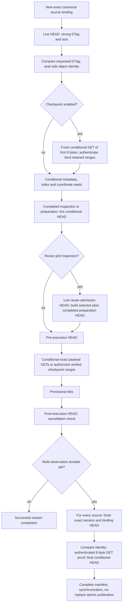
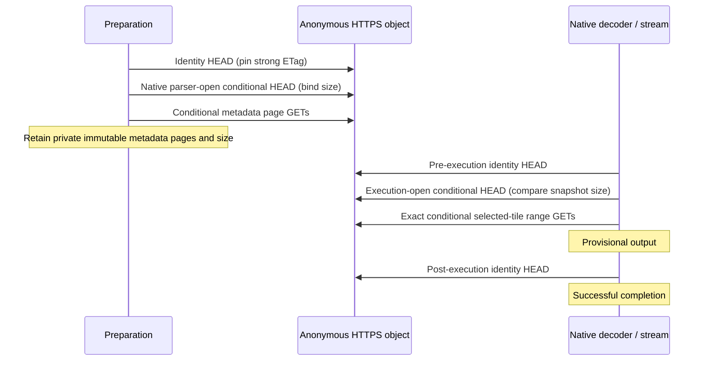

# Source-validation lifecycle

Baseline: `157facc`. The only removed observation is the second initial HEAD in
`storage::ObjectFile::open`. The first HEAD has already received and checked a
strong ETag and the complete object size. Between these two HEADs the caller
only compares the requested ETag; it consumes no source or retained bytes.
Sealing this one-object binding can therefore use that observation directly.
This is a state transition inside one call, without an age or reuse window.

## Native HDF5 / aligned SWOT

Every metadata and payload range must return 206, the exact pinned strong ETag,
the exact `Content-Range` including total object size, the exact range length,
an unencoded bounded body and exactly the requested bytes. The decoder and
scientific admission gates follow those transport checks. The full HDF5 index
validation default is unchanged.

`GridInspection` owns the same version-bound file, parsed indexes, interpreted
definitions and coordinates. `context()` checks source locator, asset identity,
requested ETag, budgets and parser policy, then validates online. A completed
inspection cannot authorize a new selected preparation by itself. There is no
reuse of a previous operation's canonical HEAD when constructing a new file.

`Context::validate_cancellable()` runs at completed preparation and on both sides
of execution. It sets the diagnostic phase to `hdf5_version_validation`; thus
three distinct lifecycle checks share that diagnostic name. Counts alone do not
identify which one established a guarantee.

The job final sweep deliberately constructs another `ObjectFile`, with a fresh
session for authenticated sources. Its binding HEAD, original identity
comparison, authorization GET and final conditional HEAD remain. The omitted
duplicate initial HEAD saves a second pair of archive/resource hops there too.
The sweep remains serial and is not an atomic snapshot of a changing collection.

## Authentication, routes and checkpoints

Authentication and checkpointing are supported here only for the explicitly
configured native HDF5 object. Native COG and Zarr v2/v3 remain anonymous; their
ordinary clients never consult credentials. Unsupported authenticated/checkpoint
requests fail admission. The milestone introduces no new authentication surface.

An authenticated logical HEAD starts at the canonical URL every time. The
fixture resolves it to the configured HEAD resource with an archive redirect.
A GET can require an OAuth/login chain and a different signed GET destination.
Only the GET route can be retained in the existing session: advertised expiry
minus 30 seconds, capped at 60 seconds. Unknown expiry resolves canonically.
Expired/rejected GET routes get at most one canonical refresh; version conflicts
do not trigger refresh. HEAD and GET destinations are never interchangeable.
Authorization goes only to the exact login origin; cookies stay at their exact
origin. Resource requests carry neither login Authorization nor cookies.

A HEAD can be public even when object bytes require permission. Consequently a
fresh checkpoint preparation always performs an online, conditional 0..8 GET
before binding or reading retained ranges. It uses an unused session and a
single-use checkpoint claim. Source locator, ETag, size, interpretation,
selection, quality policy, access policy, local range digests and checkpoint
quotas remain binding. Entirely retained acquisitions still reconstruct every
output tile, perform pre/post validation and finish successfully before their
results become durable. No signed URL is persisted.

## Native COG

This path has five HEADs in the measured direct acquisition. Parser and execution
opens bind/check size independently from the public asset's ETag. The current
COG identity resolver passes its ETag through `Asset`, rather than an opaque
size-and-version admission record to the native parser. Removing a decoder HEAD
would require a separate scoped handoff design and adversarial review. No COG
request was removed. The existing process-wide pooled HTTP **client** stores no
object identity; it is unchanged.

One preparation-local failure latch is shared by native readers and the
pre/post identity checks, including readers whose parser pages were not retained.
An observed identity, size or range failure cannot be healed by restoring the
server. Cached pages and concurrent successful responses also consult that
latch. Consumer cancellation does not set it. Separate preparations have
separate latches; there is no pooled-client or process-wide invalidation state.

COG's final identity sweep compares the ETag, while native execution-open and
range framing check snapshot size. A provider that lies about a strong ETag is
outside that ETag contract. The explicit same-ETag size-change fault receipts
record the actual baseline and candidate outcomes rather than attributing a new
guarantee to this optimization.

## Zarr v2 and v3

Both formats bind a bounded map of **individual objects**, including observed
absence. Metadata/coordinate GETs establish strong ETag and complete-body size
and retain bounded preparation-local bytes. Selected data-key HEADs establish
existence, ETag and size; they cannot be replaced by the root metadata object's
identity. A missing object uses `If-None-Match: *` on later validation.

| Operation | v2 | v3, including sharded |
|---|---|---|
| Metadata/axis admission | Per-object bounded GET; absent probes also pinned | Per-object bounded GET, including consolidated views |
| Selected data identity | HEAD for each selected physical chunk key | HEAD for each selected physical chunk/shard key |
| Preparation seal | Revalidate metadata and absent keys | Revalidate every pinned object |
| Before execution | Revalidate metadata and absent keys | Revalidate every pinned object |
| Payload | Conditional complete-object GET, ETag/length checked | Conditional full GET or exact ranges; ETag/length/total size checked |
| After execution | Revalidate metadata and absent keys | Revalidate every pinned object |
| Shard index | Not applicable | Index bytes belong to the same physical shard ETag and size as payload ranges |

V2's positive data objects have its existing per-object-at-read semantics: an
already delivered chunk is not HEAD-checked again in the final metadata sweep.
A later change to that already-read object need not invalidate the operation;
metadata changes, missing-key appearances and conflicts on unread conditional
payloads do. V3 revalidates positive data/shard objects as well. Neither format
claims an atomic collection snapshot. The matched fault matrix states these
different expected outcomes explicitly. No Zarr HEAD or payload read was removed.

## Necessary versus reusable observations

| Observation | Decision and lifetime |
|---|---|
| Initial one-file HEAD result | Use its checked ETag and size for the immediate seal in the same `ObjectFile::open` call; no intervening bytes, callbacks or reuse by locator |
| Second adjacent one-file HEAD | Removed; it only repeated the unconsumed binding's observation |
| Requested ETag comparison | Retained before parsing or checkpoint reuse |
| Online checkpoint authorization GET | Retained for each fresh checkpoint preparation, even for a complete retained source |
| Method-specific signed-route resolution and expiry | Retained inside the existing exact-object session; never identity authority |
| Conditional metadata/payload framing | Retained on every actual network read |
| Completed grid inspection | Retained after all metadata/index/coordinate inspection |
| Grid reuse admission and completed selected preparation | Both retained; callers can wait or mutate a source between these operations |
| Pre-execution validation | Retained; preparation can outlive a source version; a public HEAD alone is never treated as byte authorization |
| Post-execution validation | Retained; callback delivery is provisional |
| Job final source/session/authorization sweep | Retained before manifest/sync/publication; earlier observations can change during later acquisitions |
| Zarr per-object identities/absence | Retained independently; a root object's identity cannot authorize its collection |
| A detected terminal binding failure | Sticky for authenticated/anonymous shared-object transport and native COG; restore requires fresh preparation |

There is no time-based identity cache, new metadata container, credential
manager, background validation, new API parameter or persisted route. The
additional shared-object success-path lock check prevents an in-flight successful response
from clearing/escaping a concurrent terminal failure of its own binding.
Independent preparations still own independent bindings.

## Request-level traces

The checked-in `trace-*.json` receipts contain every fixture-observed HTTPS
request, with method, origin role, unsigned path/key, status, conditional ETag,
range, response length and source body bytes. Signed query strings and credential
values are excluded. Redirect and login hops are counted separately from logical
HEAD/GET calls. Metadata versus payload bytes are reconciled with application
phase counters and the provisional-delivery boundary.

For the frozen authenticated single SWOT source:

| Wire sequence | Baseline | Candidate | Guarantee |
|---|---:|---:|---|
| Binding HEAD: archive 303 + HEAD resource 200 | 2 | 2 | Current size and strong ETag |
| Adjacent seal HEAD: same two hops | 2 | 0 | Repeated initial binding only |
| First metadata GET authentication/signing chain before its resource response | 4 | 4 | Login permission and exact GET route |
| Conditional metadata/index/coordinate resource GETs | 21 | 21 | Exact version-bound inspected bytes |
| Completed preparation HEAD: two hops | 2 | 2 | Prepared metadata still current |
| Pre-execution HEAD: two hops | 2 | 2 | Start with current prepared version |
| Conditional five-layer payload resource GETs | 5 | 5 | Exact pinned science bytes |
| Post-execution HEAD: two hops | 2 | 2 | Completion validation |
| **Total** | **40** | **38** | Same scientific output |

The canonical URL can expose metadata without byte authorization, so the first
HEAD is not counted as a login proof. Checkpoint warm/replay traces separately
show the fresh 8-byte GET proof. Anonymous traces show one wire request per HEAD
or GET, without authentication or signed-route resolution. See `report.md` and
`summary.json` for repeated counts, body-byte accounting and timings.
